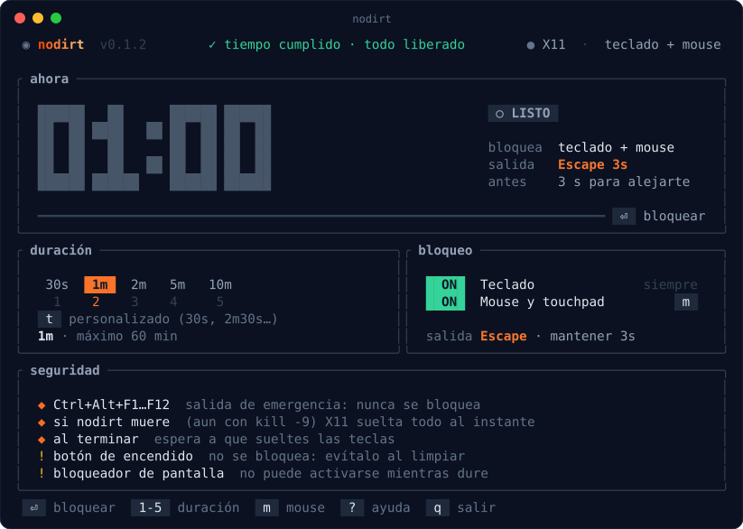
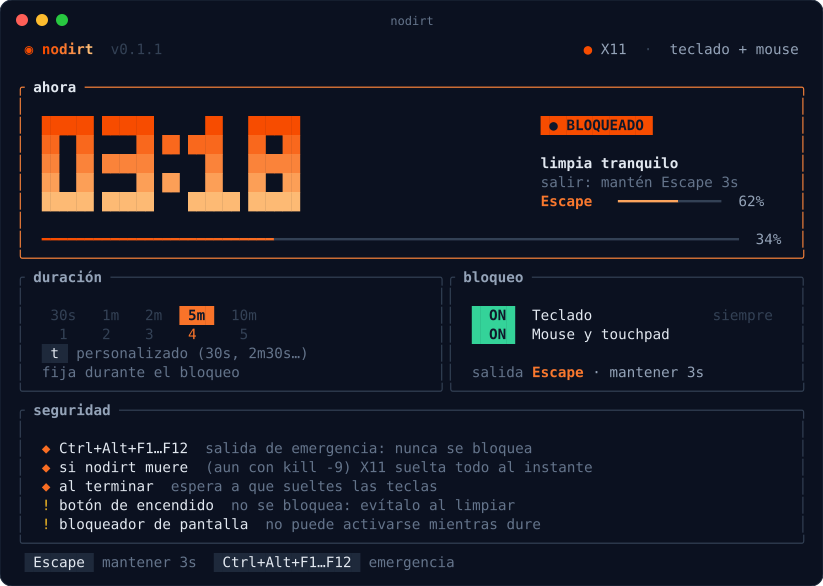
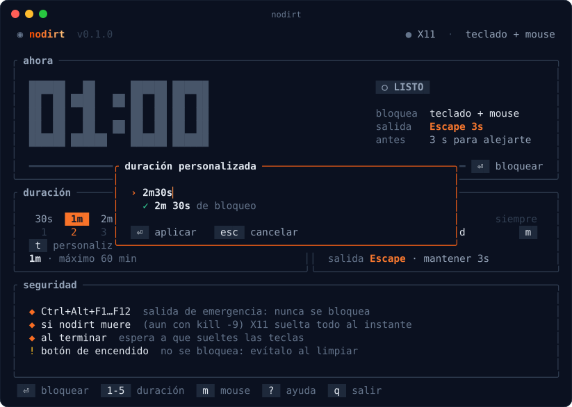

<div align="center">

# nodirt

**Bloquea teclado y mouse mientras los limpias. Con seguridad.**

Una app de terminal para Linux/X11 que captura teclado, mouse y touchpad durante un tiempo
fijo, para que puedas pasarles el paño sin escribir en tu editor ni hacer clic por el
escritorio. Siempre termina sola, y puedes salir antes manteniendo una tecla.

Español · [English](README.md)



</div>

## Lo más destacado

- **TUI interactiva.** Cuenta atrás grande, presets de una tecla, duración libre con vista
  previa en vivo y una barra de progreso para la tecla de salida. Ejecuta `nodirt` y listo.
- **Siempre termina.** Todo bloqueo tiene temporizador (de 30 s a 60 min). No existe modo
  "para siempre".
- **Salir antes, a propósito.** Mantén `Escape` 3 s (configurable) para desbloquear.
  Tocarla o pasar el paño por encima no hace nada.
- **Cuenta atrás de 3 s** antes de bloquear, para que te alejes. En la TUI la cancela
  cualquier tecla; en la CLI, `Ctrl+C`.
- **Nada se cuela después.** Al terminar espera a que sueltes todas las teclas, para que una
  tecla pulsada no repita en la ventana de debajo.
- **No te quedas atrapado.** Si `nodirt` muere, incluso con `kill -9`, el servidor X suelta
  teclado y mouse al instante. Cambiar de terminal virtual (`Ctrl+Alt+F1…F12`) nunca se
  bloquea.
- **Sin privilegios.** Sin root, sin `/dev/input`, sin `uinput`: solo grabs de X11.
- **Un único binario estático.** Habla el protocolo X11 directamente en Rust puro. Sin
  `libX11`, sin `xinput`, sin dependencias en tiempo de ejecución.

## Instalación

### Binario precompilado

Cada versión etiquetada publica binarios estáticos en la
[página de Releases](https://github.com/AngheloBR/nodirt-tui/releases). No hace falta Rust
ni paquetes extra:

```sh
curl -fsSL https://github.com/AngheloBR/nodirt-tui/releases/latest/download/nodirt-x86_64-unknown-linux-musl.tar.gz \
  | tar xz --strip-components=1 -C ~/.local/bin nodirt-x86_64-unknown-linux-musl/nodirt
```

En ARM usa `aarch64-unknown-linux-musl`. Cada release incluye también su checksum
`.sha256`.

### Fedora / RHEL / openSUSE (.rpm) · Debian / Ubuntu / Mint (.deb)

Descarga el paquete para tu sistema desde la
[última release](https://github.com/AngheloBR/nodirt-tui/releases/latest) e instálalo con
tu gestor de paquetes:

```sh
sudo dnf install ./nodirt-tui-*.x86_64.rpm     # Fedora, RHEL
sudo apt install ./nodirt-tui_*_amd64.deb      # Debian, Ubuntu, Mint
```

El binario de dentro es estático, así que el mismo paquete sirve en versiones antiguas y
nuevas. Para desinstalar: `sudo dnf remove nodirt-tui` / `sudo apt remove nodirt-tui`.

### Desde el código

Requiere Rust 1.88+.

```sh
cargo install --git https://github.com/AngheloBR/nodirt-tui
```

### Requisitos

- Linux con una sesión **X11**. Wayland se rechaza a propósito: los grabs de X11 no frenan a
  las apps nativas de Wayland, así que solo *parecería* bloqueado.

## La TUI

Ejecuta `nodirt` sin argumentos.



| Tecla               | Acción                                          |
| ------------------- | ----------------------------------------------- |
| `Enter` / `Espacio` | bloquear (tras la cuenta atrás de 3 s)          |
| `1` … `5`           | 30s · 1m · 2m · 5m · 10m                        |
| `←` `→`             | duración anterior / siguiente                   |
| `t`                 | duración personalizada, con vista previa        |
| `m`                 | bloquear también mouse y touchpad (sí por defecto) |
| `?`                 | ayuda                                           |
| `q` / `Esc`         | salir                                           |

Durante el bloqueo la terminal no recibe nada: la tecla de salida se lee directamente de X11.





## La CLI

Con cualquier opción, `nodirt` funciona como un comando normal:

```sh
nodirt -t 2m                          # bloquea teclado + mouse 2 minutos
nodirt -t 1m30s --no-mouse            # solo el teclado
nodirt -t 5m --unlock-key F12 --unlock-hold 5s
nodirt --tui -t 10m                   # abre la TUI con 10m preseleccionado
```

### Duraciones

La unidad es obligatoria: `90` se rechaza en vez de adivinar.

| Entrada                | Significado                     |
| ---------------------- | ------------------------------- |
| `30s` `1m` `1h`        | segundos, minutos, horas        |
| `2m30s` / `2m 30s`     | combinadas                      |
| `60m`                  | máximo                          |

### Opciones

| Opción                 | Descripción                                                |
| ---------------------- | ---------------------------------------------------------- |
| `-t, --time DUR`       | Cuánto dura el bloqueo (por defecto `1m`, máximo `60m`)    |
| `--unlock-key TECLA`   | Tecla a mantener para salir antes: `Escape`, `F1`…`F12`, `space`, `Return`, `a`…`z`, `0`…`9`… (por defecto `Escape`) |
| `--unlock-hold DUR`    | Cuánto mantenerla, `1s`…`10s` (por defecto `3s`)           |
| `--no-mouse`           | Bloquear solo el teclado                                   |
| `--tui`                | Abrir la TUI usando estas opciones como valores iniciales  |

### Códigos de salida

| Código | Significado                                                              |
| ------ | ------------------------------------------------------------------------ |
| `0`    | bloqueo terminado (temporizador o tecla de salida)                       |
| `1`    | error inesperado                                                         |
| `2`    | uso inválido                                                             |
| `3`    | no se pudo capturar teclado/mouse (sin X11, o lo tiene otro programa)    |
| `130`  | cancelado (cuenta atrás interrumpida, o `SIGINT`/`SIGTERM`/`SIGHUP`)     |

## Cómo funciona

```
cuenta atrás 3 s ──▶ GrabKeyboard + GrabPointer sobre la ventana raíz (owner_events = false)
                     todo o nada; si otro programa los tiene, reintenta hasta 3 s
                     └─▶ cada tecla y clic va a nodirt y a ningún otro sitio

bloqueado ──▶ se acaba el tiempo ─┐
          └─▶ tecla de salida     ┴─▶ espera a que se suelten las teclas (máx. 2 s) ──▶ libera
```

- **El autorepeat** se detecta con `DetectableAutoRepeat` de XKB, activado solo para la
  conexión de nodirt. No cambia nada global, así que no hay nada que restaurar.
- **La liberación** ocurre al acabar el tiempo, con la tecla de salida, con
  `SIGINT`/`SIGTERM`/`SIGHUP`, ante errores y ante panics. Si el proceso muere de golpe, el
  servidor X suelta los grabs al cerrarse su conexión.

## Seguridad y limitaciones

- **Salida de emergencia:** `Ctrl+Alt+F1…F12` cambia de terminal virtual y nunca se bloquea.
- **El botón de encendido no se bloquea.** Lo gestiona systemd-logind, no X11. Evítalo al
  limpiar.
- **Los bloqueadores de pantalla no pueden activarse mientras dura.** `i3lock`, `xss-lock`,
  `slock` y similares también necesitan capturar el teclado, y nodirt lo tiene. Si te alejas
  durante un bloqueo largo, la pantalla queda sin bloquear hasta que termine.
- **Los demonios de gestos del touchpad** que leen `/dev/input` directamente (`touchegg`,
  `fusuma`, `libinput-gestures`) se saltan X11 y no se bloquean.
- **Las pantallas táctiles** no están soportadas en esta versión.
- **Solo X11.** Ver [Requisitos](#requisitos).

## Desarrollo

```sh
cargo test
cargo clippy --all-targets -- -D warnings
cargo test --test xvfb -- --ignored   # grabs reales en un Xvfb privado (necesita Xvfb + xdotool)
cargo test snapshots -- --ignored     # regenera las capturas de docs/
cargo test demo -- --ignored          # regenera el demo animado (docs/demo.svg)
```

Los tests de integración arrancan su propio servidor Xvfb y nunca tocan tu sesión.
Comprueban que, durante el bloqueo, las teclas y clics de `xdotool` no llegan a un segundo
cliente, y que sí llegan después del temporizador, de la tecla de salida y de `kill -9`.
El CI los ejecuta en cada push.

Las capturas y el demo salen del propio código que dibuja la TUI, así que siempre coinciden
con la app.

## Licencia

Doble licencia [MIT](LICENSE-MIT) o [Apache-2.0](LICENSE-APACHE), a tu elección.
