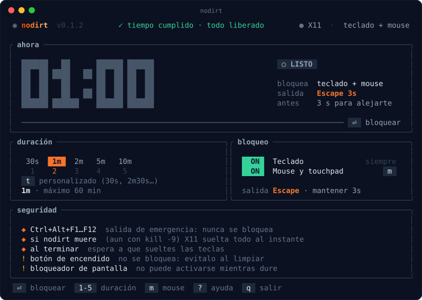
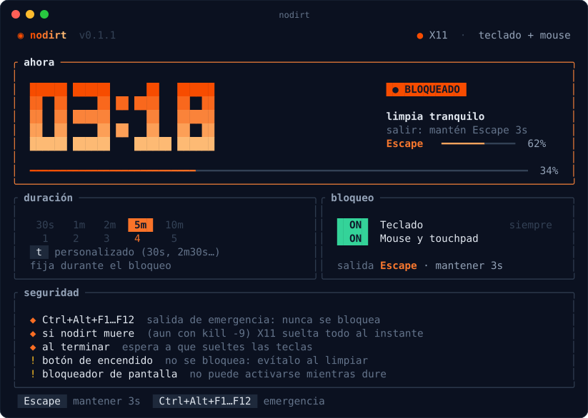
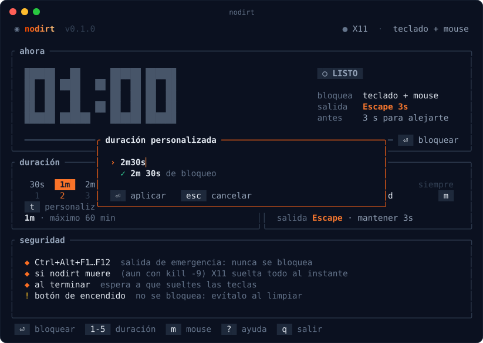

<div align="center">

# nodirt

**Lock your keyboard and mouse while you clean them. Safely.**

A terminal app for Linux/X11 that captures keyboard, mouse and touchpad for a fixed time,
so you can wipe them without typing into your editor or clicking through your desktop.
It always ends on its own, and you can leave early by holding a key.

[Español](README.es.md) · English



</div>

## Highlights

- **Interactive TUI.** Big countdown, one-key presets, free-form durations with a live
  preview, and a progress bar for the unlock key. Run `nodirt` and you're in.
- **Always ends.** Every lock has a timer (30 s to 60 min). There is no "forever" mode.
- **Leave early, on purpose.** Hold `Escape` for 3 s (configurable) to unlock. Tapping it,
  or wiping across it, does nothing.
- **3-second countdown** before locking, so you can step away. Any key cancels it in the
  TUI; `Ctrl+C` does in the CLI.
- **Nothing leaks afterwards.** When the lock ends it waits until you release every key,
  so a held key can't autorepeat into the window underneath.
- **Can't get stuck.** If `nodirt` dies, even by `kill -9`, the X server releases keyboard
  and mouse at once. Switching virtual terminals (`Ctrl+Alt+F1…F12`) is never blocked.
- **No privileges.** No root, no `/dev/input`, no `uinput`: plain X11 grabs.
- **One static binary.** Speaks the X11 protocol directly in pure Rust. No `libX11`, no
  `xinput`, no runtime dependencies.

## Install

### Prebuilt binary

Each tagged version publishes static binaries on the
[Releases page](https://github.com/AngheloBR/nodirt-tui/releases). No Rust and no extra
packages needed:

```sh
curl -fsSL https://github.com/AngheloBR/nodirt-tui/releases/latest/download/nodirt-x86_64-unknown-linux-musl.tar.gz \
  | tar xz --strip-components=1 -C ~/.local/bin nodirt-x86_64-unknown-linux-musl/nodirt
```

On ARM use `aarch64-unknown-linux-musl` instead. Every release also ships a `.sha256`
checksum.

### Fedora / RHEL / openSUSE (.rpm) · Debian / Ubuntu / Mint (.deb)

Download the package for your system from the
[latest release](https://github.com/AngheloBR/nodirt-tui/releases/latest) and install it
with your package manager:

```sh
sudo dnf install ./nodirt-tui-*.x86_64.rpm     # Fedora, RHEL
sudo apt install ./nodirt-tui_*_amd64.deb      # Debian, Ubuntu, Mint
```

The binary inside is static, so the same package works on old and new releases alike.
Uninstall with `sudo dnf remove nodirt-tui` / `sudo apt remove nodirt-tui`.

### From source

Requires Rust 1.88+.

```sh
cargo install --git https://github.com/AngheloBR/nodirt-tui
```

### Requirements

- Linux with an **X11** session. Wayland is refused on purpose: X11 grabs don't stop
  native Wayland apps, so it would only *look* locked.

## The TUI

Run `nodirt` with no arguments.



| Key                 | Action                                        |
| ------------------- | --------------------------------------------- |
| `Enter` / `Space`   | lock (after the 3-second countdown)           |
| `1` … `5`           | 30s · 1m · 2m · 5m · 10m                      |
| `←` `→`             | previous / next duration                      |
| `t`                 | custom duration, with a live preview          |
| `m`                 | also lock mouse and touchpad (on by default)  |
| `?`                 | help                                          |
| `q` / `Esc`         | quit                                          |

While locked the terminal receives nothing: the unlock key is read straight from X11.





## The CLI

Any flag runs `nodirt` as a plain command:

```sh
nodirt -t 2m                          # lock keyboard + mouse for 2 minutes
nodirt -t 1m30s --no-mouse            # keyboard only
nodirt -t 5m --unlock-key F12 --unlock-hold 5s
nodirt --tui -t 10m                   # open the TUI with 10m preselected
```

### Durations

A unit is always required, so `90` is rejected rather than guessed.

| Input                  | Meaning                         |
| ---------------------- | ------------------------------- |
| `30s` `1m` `1h`        | seconds, minutes, hours         |
| `2m30s` / `2m 30s`     | combined                        |
| `60m`                  | maximum                         |

### Options

| Flag                   | Description                                                |
| ---------------------- | ---------------------------------------------------------- |
| `-t, --time DUR`       | How long to lock (default `1m`, maximum `60m`)             |
| `--unlock-key KEY`     | Key to hold to leave early: `Escape`, `F1`…`F12`, `space`, `Return`, `a`…`z`, `0`…`9`… (default `Escape`) |
| `--unlock-hold DUR`    | How long to hold it, `1s`…`10s` (default `3s`)             |
| `--no-mouse`           | Lock the keyboard only                                     |
| `--tui`                | Open the TUI using the flags above as starting values      |

### Exit codes

| Code  | Meaning                                                              |
| ----- | -------------------------------------------------------------------- |
| `0`   | lock finished (timer or unlock key)                                  |
| `1`   | unexpected error                                                     |
| `2`   | invalid usage                                                        |
| `3`   | couldn't capture keyboard/mouse (no X11, or another app holds them)  |
| `130` | cancelled (countdown interrupted, or `SIGINT`/`SIGTERM`/`SIGHUP`)    |

## How it works

```
countdown 3 s ──▶ GrabKeyboard + GrabPointer on the root window (owner_events = false)
                   all or nothing; if another app holds them, retry for up to 3 s
                   └─▶ every key and click goes to nodirt and nowhere else

locked ──▶ timer runs out ─┐
       └─▶ unlock key held ┴─▶ wait until all keys are released (max 2 s) ──▶ ungrab
```

- **Autorepeat** is detected with XKB `DetectableAutoRepeat`, set for nodirt's own connection
  only. Nothing global changes, so there is nothing to restore.
- **Release** happens on timer, unlock key, `SIGINT`/`SIGTERM`/`SIGHUP`, errors and panics.
  If the process is killed outright, the X server drops the grabs when its connection
  closes.

## Safety and limitations

- **Emergency exit:** `Ctrl+Alt+F1…F12` switches virtual terminals and is never blocked.
- **The power button is not blocked.** It belongs to systemd-logind, not X11. Avoid it while
  cleaning.
- **Screen lockers can't kick in while it runs.** `i3lock`, `xss-lock`, `slock` and friends
  need to grab the keyboard too, and nodirt is holding it. If you walk away during a long
  lock, your screen stays unlocked until it ends.
- **Touchpad gesture daemons** that read `/dev/input` directly (`touchegg`, `fusuma`,
  `libinput-gestures`) bypass X11 and are not blocked.
- **Touchscreens** are not supported in this version.
- **X11 only.** See [Requirements](#requirements).

## Development

```sh
cargo test
cargo clippy --all-targets -- -D warnings
cargo test --test xvfb -- --ignored   # real grabs on a private Xvfb (needs Xvfb + xdotool)
cargo test snapshots -- --ignored     # regenerate the screenshots in docs/
cargo test demo -- --ignored          # regenerate the animated demo (docs/demo.svg)
```

The integration tests start their own Xvfb server and never touch your session. They check
that, while locked, `xdotool` keys and clicks don't reach a second client, and that they do
again after the timer, after the unlock key and after `kill -9`. CI runs them on every push.

The screenshots and the demo are produced by the TUI's own drawing code, so they always
match the app.

## License

Dual-licensed under [MIT](LICENSE-MIT) or [Apache-2.0](LICENSE-APACHE), at your option.
